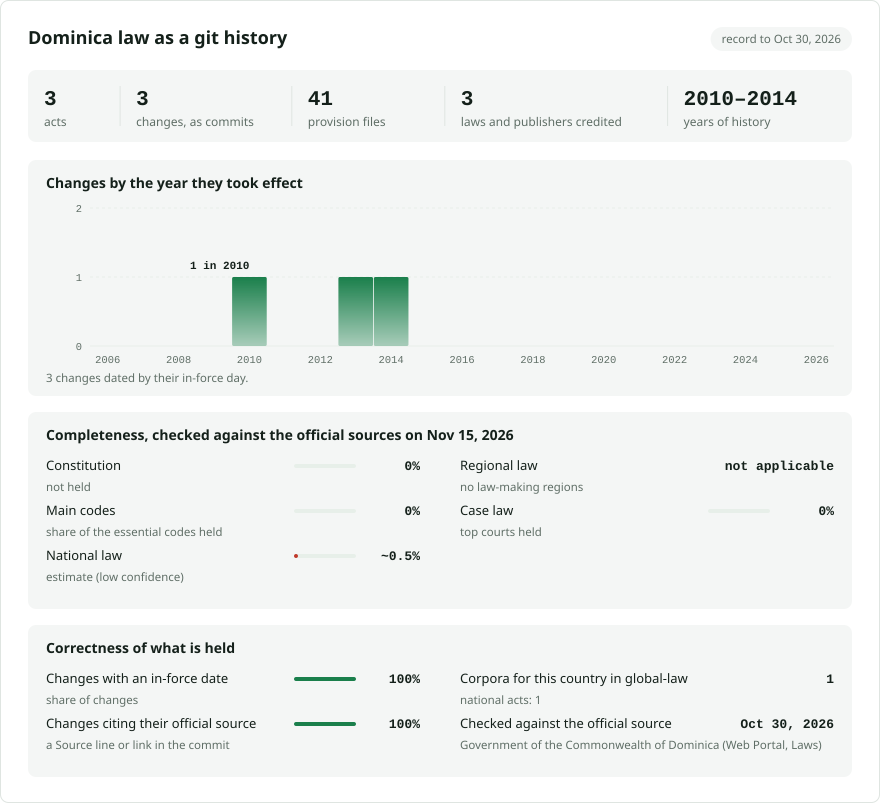

# Dominica: law history in git

<picture>
<source media="(prefers-color-scheme: dark)" srcset="data/effort-dark.svg">

</picture>

The law of Dominica as a git history: one file per section, one commit per version on the day it took effect, and the law that made each change as the commit's author. `git blame` names the law behind every line; `git log` lists every change to a section; picking a date gives the text in force that day.

Part of [lexifina/global-law](https://github.com/lexifina/global-law), one git history for every country's law: this is Dominica's national law, which global-law reads at `dominica/national/acts/`.

**What is in it now:** three instruments, 38 provisions in all, each in one version, as enacted: the Electronic Evidence Act, 2010 (Act 13 of 2010), in force from 17 June 2010; the Electronic Filing Act, 2013 (Act 20 of 2013), from 1 October 2013; and the Commonwealth of Dominica Citizenship by Investment Regulations, 2013 (S.R.O. 43 of 2013), from 9 January 2014. [`data/laws.csv`](data/laws.csv) lists each with the days it was enacted, published and took effect; each folder's `README.md` lists its provisions.

Each instrument has its own folder, one file per section or regulation, with its preamble and schedule: `citizenship-by-investment-regulations-2013/sec-005.md` is regulation 5 of the Citizenship by Investment Regulations (real estate and other approved investments) and `citizenship-by-investment-regulations-2013/schedule.md` their Schedule, the fees and minimum investments.

The text is in English, the official language, as the text layer of the Government's PDFs gives it; page headers and page numbers are removed.

## Questions as git commands

| Question | Command |
| --- | --- |
| Every change to the Schedule of the Citizenship by Investment Regulations | `git log -p --word-diff -- citizenship-by-investment-regulations-2013/schedule.md` |
| Which law wrote each line of the Schedule? | `git blame citizenship-by-investment-regulations-2013/schedule.md` |
| Every version of the Regulations, with the day each took effect | `git log --format="%h %(trailers:key=In-force,valueonly,separator=) %an" -- citizenship-by-investment-regulations-2013 ':!*/README.md'` |
| The Schedule as in force on 1 January 2020 | `python tools/on.py 2020-01-01 citizenship-by-investment-regulations-2013 schedule` |

**Outside git**, we also host this record publicly, for free:

- **[Ask Claude about Dominican law](https://global-law.lexifina.com/v1/try_claude?country=dominica)**: opens Claude with a first question ready.
- **[Ask ChatGPT](https://global-law.lexifina.com/v1/try_chatgpt?country=dominica)**: the same question in ChatGPT.
- **[Search Dominican law on our site](https://lexifina.com/law?country=dominica&q=citizenship+by+investment)**: a search for "citizenship by investment", with each provision's text and its versions, no account needed.
- **[Developer REST API](https://global-law.lexifina.com/v1/search_law?query=citizenship+by+investment&jurisdiction=dominica)**: the same search as JSON, with no key. See the [documentation here](https://lexifina.com/api/global-law).

Both assistants read the record through the free Global law connector (MCP, `https://global-law.lexifina.com/mcp`); the first time, the chat gives you the link that adds it. Ask in English.

**Host it yourself easily.** All it takes is git and Python, and the tools run on your machine:

```sh
git clone --depth 1 https://github.com/lexifina/global-law && cd global-law
python3 tools/countries.py add dominica/national/acts
python3 tools/law.py show 2026-01-01 dominica/national/acts/citizenship-by-investment-regulations-2013/schedule.md
```

Opened in Claude Code, Cursor, VS Code or Codex, the clone also starts a local MCP server with the same tools ([MCP.md](https://github.com/lexifina/global-law/blob/main/MCP.md)).

## Dates

Each commit is dated at noon, America/Dominica, on the day the instrument took effect, and carries it in its `In-force:` trailer; `Enacted:` and `Published:` give the other two days:

- the day the instrument's own commencement clause gives (the Electronic Filing Act: 1 October 2013, by section 1(2), although it was assented to on 18 November and gazetted on 28 November 2013);
- where it has none, the day it was published in the Gazette (the Electronic Evidence Act: 17 June 2010; the Citizenship by Investment Regulations: 9 January 2014).

Each instrument is credited to itself, as enacted (`Act 20 of 2013 <act-20-2013@dominica.gov.dm.invalid>`, an address that cannot exist).

## How it is checked

- `tools/check_repo.py` reads every version back from git on the day it took effect and on the day before, and compares it with the corpus it was built from: 3 versions of 3 acts, 0 mismatches.
- Every commit's trailers parse; there are no merge commits, no commit dates that go backwards and none after the build.
- A second build from the same corpus gave identical hashes for all 3 law commits and 6 tags. The results, the corpus's sha256 and the builder's hashes are in [`REPRODUCE.md`](REPRODUCE.md).

## What it does not show

- **The Constitution and the Revised Laws of Dominica.** The portal's Revised Laws chapters, the Constitution Order (Chapter 1:01) and the criminal, evidence, labour and interpretation statutes among them, are scans without a text layer; no OCR was used.
- **Other Acts, statutory rules and orders, and case law.** Only these three instruments are here.
- **Amendments.** The portal publishes each instrument as passed, not consolidated; later amending instruments are not applied, so this is not the text in force today.
- **The printed layout.** Marginal notes appear inside the section text where the PDF's text layer places them, and some words run together as it gives them.

## Sources

| Source | Kind | Past versions | Notes |
| --- | --- | --- | --- |
| [Laws of Dominica](https://dominica.gov.dm/laws-of-dominica) (Government of the Commonwealth of Dominica) | Official legislation portal | no: Acts and statutory rules and orders as passed, not consolidated | The PDFs of the three instruments, retrieved 29 and 30 October 2026 |

## Licence

See [`LICENSE`](LICENSE). The laws are official publications of the Government of the Commonwealth of Dominica, whose portal states no reuse licence; the wording of the law is not changed. The history, commit messages, tables and tools are CC0 1.0.

No AI model wrote or changed legal text; the scripts were written by an AI model (see [`REPRODUCE.md`](REPRODUCE.md)).

## More

From [lexifina/global-law](https://github.com/lexifina/global-law):

- [FEATURES.md](https://github.com/lexifina/global-law/blob/main/FEATURES.md): every feature, and what every corpus must support (`git blame`, `law.py`, the MCP tools)
- [FAQ.md](https://github.com/lexifina/global-law/blob/main/FAQ.md): questions and answers · [CONTRIBUTING.md](https://github.com/lexifina/global-law/blob/main/CONTRIBUTING.md): proposing changes · [MCP.md](https://github.com/lexifina/global-law/blob/main/MCP.md): the MCP server · [REPRODUCE.md](https://github.com/lexifina/global-law/blob/main/REPRODUCE.md): how it was built · [CHANGELOG.md](https://github.com/lexifina/global-law/blob/main/CHANGELOG.md)
- [FRESHNESS.md](https://github.com/lexifina/global-law/blob/main/FRESHNESS.md): how current each corpus is · [Monitoring](https://github.com/lexifina/global-law/tree/main/monitoring): whether updates are running · [WATCHING.md](https://github.com/lexifina/global-law/blob/main/WATCHING.md): how each official source is watched for changes
- [performance/](https://github.com/lexifina/global-law/tree/main/performance): how fast the tools are, measured
- [visualisations/](https://github.com/lexifina/global-law/tree/main/visualisations): charts and bridges across the world's law
- [Vulnerabilities](https://github.com/lexifina/global-law/tree/main/vulnerabilities): mistakes in legislation as published
